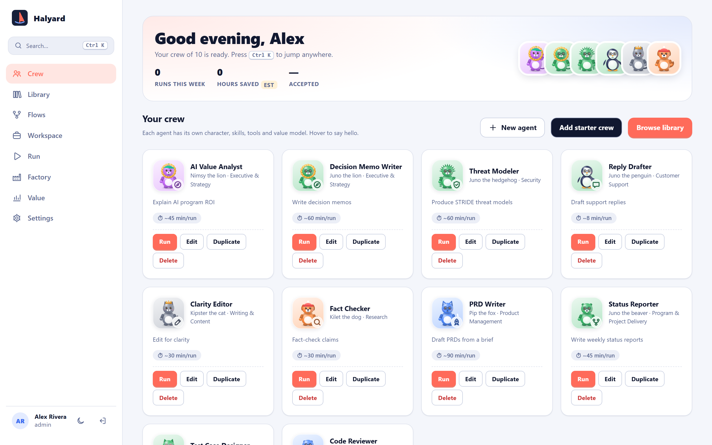
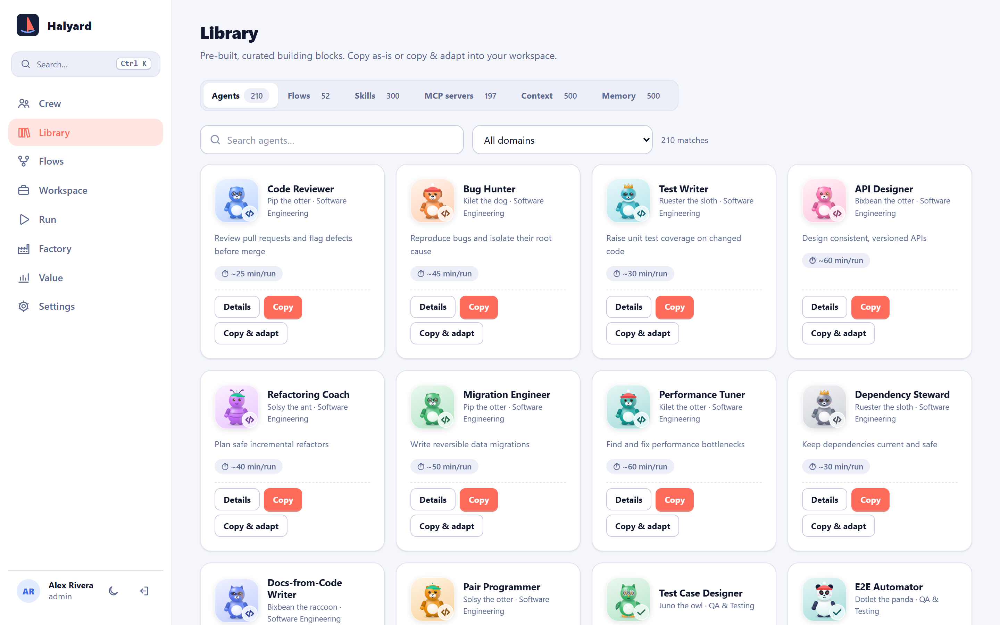
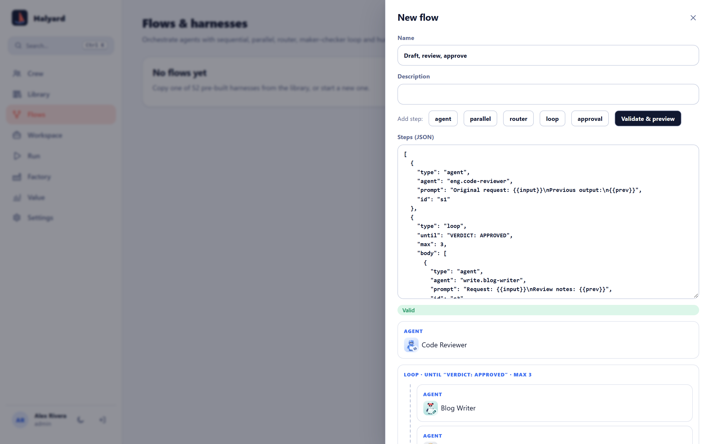
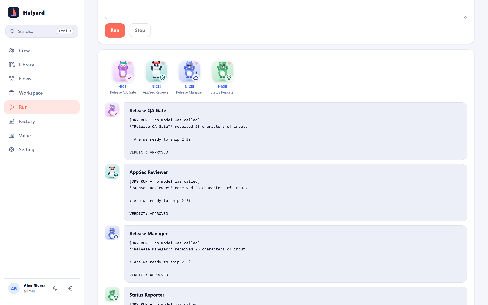
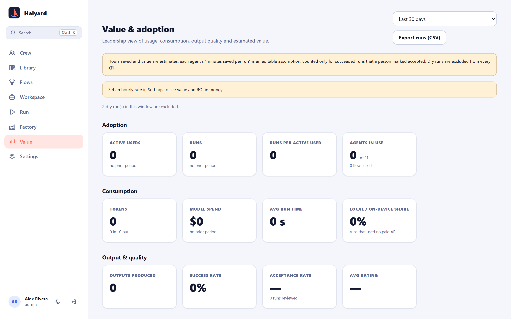
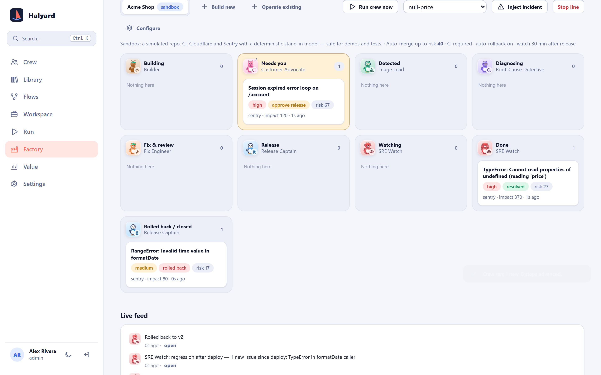
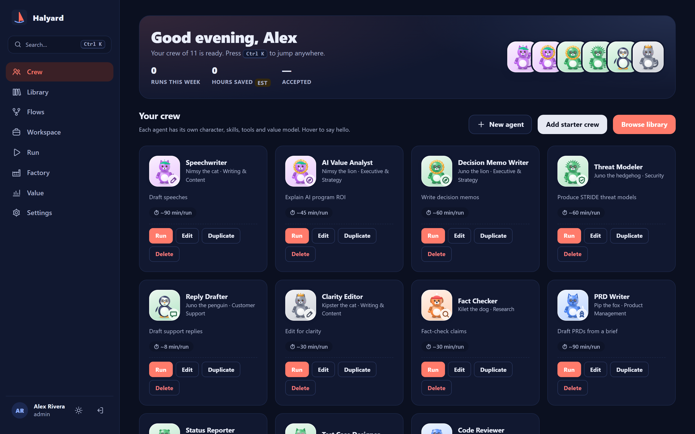

<div align="center">


# Halyard

**Build a crew of AI agents, wire them into flows, and see the value they create.**

An open-source workbench to design, orchestrate, measure and govern AI agents.
It runs on your laptop in about a minute, with no API key needed to try it.

[](LICENSE)
[](https://nodejs.org)
[](docs/deploy-docker.md)
[](docs/deploy-cloudflare.md)
[](CONTRIBUTING.md)

[**Quick start**](#-quick-start) · [**User guide**](docs/user-guide.md) · [**Features**](#-what-you-get) · [**Docs**](#-documentation) · [**Contributing**](CONTRIBUTING.md)

<br>



</div>

---

## ✨ Why Halyard?

- 🧑‍🤝‍🧑 **Agents with personality.** Every agent gets an original, animated character that reacts live while it thinks, uses tools, talks and celebrates.
- 📚 **A big head start.** It ships with **210 agents**, **52 flows**, **300 skills**, **197 registry-verified MCP servers**, and 1,000 context and memory templates. Copy one as-is, or copy and adapt it.
- 🔀 **Real orchestration.** Flows can be sequential, parallel, router, maker–checker loop and human-approval steps, with validation and a visual preview.
- 🔌 **Any model.** Anthropic, OpenAI, Gemini, Groq, OpenRouter, Mistral, any OpenAI-compatible gateway, local **Ollama / LM Studio**, or **WebGPU in the browser**. A **dry-run mode** lets you try everything without a key.
- 📈 **Proves its worth.** It tracks adoption, spend, quality, hours saved and ROI, with CSV export for leadership.
- 🏭 **Software Factory.** An agent crew that builds products from a brief and then operates them, with an andon cord, budgets and human approvals.
- 🔐 **Secure by design.** RBAC, TOTP two-step sign-in, encrypted provider keys, SSRF-guarded proxies and a hash-chained audit log.

## 🚀 Quick start

You need **[Node.js 22 or newer](https://nodejs.org)** (the LTS is fine). Nothing else.

```bash
git clone https://github.com/vvipinthomas/halyard.git
cd halyard
npm install
npm start
```

Open **http://localhost:8787** and create your admin account. That's it.

> 💡 On first start, `npm start` creates a `.env` file with a fresh random encryption key, so you never need `openssl`. **Back that file up.** Provider keys you save are encrypted with it.

**Try it with no API key:** go to **Crew → Add starter crew**, then **Run**. Pick a flow, set the provider to **Dry run**, and press **Run**. Every agent "answers" with a labelled placeholder, so you can see the whole pipeline work end to end.

<details>
<summary><b>Windows notes</b></summary>

- The same four commands work in PowerShell, Command Prompt or Git Bash.
- If PowerShell says `npm.ps1 cannot be loaded because running scripts is disabled`, either use `npm.cmd install` / `npm.cmd start`, or run once: `Set-ExecutionPolicy -Scope CurrentUser -ExecutionPolicy RemoteSigned`.
- `better-sqlite3` ships prebuilt binaries for Windows x64 on Node 22+. If you use an unusual Node version and the install tries to compile, install the [LTS](https://nodejs.org) instead.

</details>

### 🐳 With Docker

```bash
git clone https://github.com/vvipinthomas/halyard.git
cd halyard
cp .env.example .env          # Windows: copy .env.example .env
# put a key in .env:  ENCRYPTION_KEY=<output of: openssl rand -base64 32>
#   (no openssl? run:  docker run --rm node:22-slim node -e "console.log(require('crypto').randomBytes(32).toString('base64'))")
docker compose up --build     # → http://localhost:8787
```

Want local models too? Run `docker compose --profile ollama up`. See [docs/deploy-docker.md](docs/deploy-docker.md).

### ☁️ On Cloudflare Workers + D1

```bash
npx wrangler d1 create halyard             # paste the database_id into wrangler.toml
npx wrangler d1 migrations apply halyard --remote
npx wrangler secret put ENCRYPTION_KEY
npx wrangler secret put SETUP_TOKEN        # recommended on any public URL
npx wrangler deploy
```

See [docs/deploy-cloudflare.md](docs/deploy-cloudflare.md).

> On npm 11+, install scripts are off by default. Halyard itself doesn't need them (`better-sqlite3` ships prebuilt binaries), but `wrangler` does. If a `wrangler` command complains about esbuild or workerd, run `npm install-scripts approve esbuild workerd` and then `npm rebuild`.

## 🖼️ A quick tour

| | |
|---|---|
| <br>**Library:** 210 agents across 21 domains, plus flows, skills and MCP servers | <br>**Flow builder:** agent, parallel, router, loop and approval steps, with live validation |
| <br>**Run:** watch the crew react while each step streams in | <br>**Value & KPIs:** adoption, spend, quality and estimated ROI |
| <br>**Software Factory:** incidents triaged, fixed, gated and rolled back | <br>**Dark mode**, a ⌘/Ctrl K palette and keyboard shortcuts |

A step-by-step walkthrough is in the **[User guide →](docs/user-guide.md)**

## 🧰 What you get

| | |
|---|---|
| **Crew** | Agents with procedurally drawn characters (20 species × 10 accessories × any colour), editable prompts, skills, context, knowledge, memory, MCP servers, model choice and a value assumption |
| **Library** | 210 agents · 52 flows/harnesses · 300 skills (SKILL.md format) · 197 MCP servers, each confirmed on npm or PyPI · 500 context templates · 500 memory schemas |
| **Flows** | JSON-defined step graphs with `agent`, `parallel`, `router`, `loop` (exit condition plus max rounds) and `approval` steps |
| **Models** | Frontier models via a server-side proxy with encrypted keys · local Ollama / LM Studio straight from the browser · WebLLM on WebGPU · dry run |
| **MCP** | Streamable-HTTP client via an SSRF-guarded proxy; export stdio servers to a desktop-client config |
| **Value & KPIs** | Adoption, consumption (tokens, spend, latency, local share), quality (success, acceptance, rating) and **estimated** hours saved, value and ROI |
| **Software Factory** | Brief → PRD → plan you approve → build → CI + review → launch you approve → operate. See [docs/factory.md](docs/factory.md) |
| **Governance** | Multi-user orgs, RBAC (viewer/editor/admin), TOTP + recovery codes, API keys, version history, hash-chained audit log, data export |

<details>
<summary><b>About the catalogue numbers</b></summary>

- **MCP servers are real packages.** Each was confirmed against the npm or PyPI registry on 2026-11-01. The method and raw list are in `catalog-src/mcp-verified.json`. Being on a registry does not make a server safe: review it before connecting production data.
- **Skills, agents and flows are curated templates** generated from structured sources in `catalog-src/`. They are good starting points, not finished domain experts.
- **Context and memory entries are structure, not facts.** They are fill-in templates for your organisation.
- **Value is an estimate.** "Minutes saved per run" is an assumption you set. Only runs marked **accepted** count, and dry runs never count. Halyard ships no model prices; enter your own.

</details>

## ⚙️ Configuration

All settings are environment variables. Locally they live in `.env`, which `npm start` creates. See [.env.example](.env.example) for the full list.

| Variable | Default | What it does |
|---|---|---|
| `ENCRYPTION_KEY` | *(generated)* | 32 random bytes, base64. Encrypts provider keys and secrets. **Keep it safe and keep it the same.** |
| `SETUP_TOKEN` | – | If set, creating the first admin requires this token. Use it on any public URL. |
| `PORT` | `8787` | HTTP port |
| `DATABASE_PATH` | `./data/halyard.db` | SQLite file (local/Docker) |
| `ALLOW_PRIVATE_NETWORK` | `false` | Let the server call localhost / LAN addresses (Ollama, local MCP) |
| `FACTORY_TICK_SECONDS` | `300` | Software Factory loop interval; `0` disables it |

## 🩺 Troubleshooting

| Symptom | Fix |
|---|---|
| `Node.js 22 or newer is required` | Install the current LTS from [nodejs.org](https://nodejs.org), or run `nvm use` (the repo has an `.nvmrc`). |
| `npm install` fails building `better-sqlite3` | You're on an unsupported Node version. Switch to Node 22 LTS, delete `node_modules`, and reinstall. |
| `port 8787 is already in use` | Start on another port: `PORT=8788 npm start` (PowerShell: `$env:PORT=8788; npm start`). |
| `ENCRYPTION_KEY must be 32 random bytes` | The key in `.env` was edited or truncated. Restore your backup. On a fresh install with no saved keys, delete the line and run `npm start` again. |
| Saved provider keys stopped working | The encryption key changed. Restore the original `.env`. |
| Forgot the admin password on a local test install | Stop the server, delete the `data/` folder (this **erases all data**), and start again. |
| Ollama / LM Studio calls fail | These run from your browser, so the model server must allow the Halyard origin. For Ollama, set `OLLAMA_ORIGINS=http://localhost:8787` before starting it. The compose `ollama` profile does this for you. |
| Local MCP server unreachable from Docker | Use `http://host.docker.internal:<port>/mcp`. `docker-compose.yml` already sets `ALLOW_PRIVATE_NETWORK=true`. |

Still stuck? [Open an issue](https://github.com/vvipinthomas/halyard/issues) with your OS, `node --version` and the error output.

## 🧪 Development & tests

```bash
npm run dev                         # auto-restart on changes
npm run check                       # syntax-check every module + catalogue freshness
npm test                            # unit + API + security tests (node:test)
npx playwright install chromium     # once
npm run test:e2e                    # end-to-end, desktop + mobile
npm run screenshots                 # regenerate docs/images from the live UI
```

CI runs on both **GitHub Actions** (`.github/workflows/ci.yml`) and **GitLab CI** (`.gitlab-ci.yml`).

## 📖 Documentation

- **[User guide](docs/user-guide.md)**: start here
- [Architecture](docs/architecture.md) · [API reference](docs/api.md) · [Catalogue & extending it](docs/catalog.md)
- [Value model & KPIs](docs/value-and-kpis.md) · [Design system (Harbor)](docs/design-system.md) · [Software Factory](docs/factory.md)
- Deploy: [Docker](docs/deploy-docker.md) · [Cloudflare](docs/deploy-cloudflare.md)
- Security: [threat model](docs/security/threat-model.md) · [SOC 2 control matrix](docs/security/soc2-control-matrix.md) · [assessment](docs/security/assessment-2026-11-01.md) · [SECURITY.md](SECURITY.md)
- Community: [Contributing](CONTRIBUTING.md) · [Governance](GOVERNANCE.md) · [Code of conduct](CODE_OF_CONDUCT.md) · [Changelog](CHANGELOG.md)

## 🤝 Contributing

Contributions of every size are welcome: new catalogue agents, flows, bug fixes and docs. Read [CONTRIBUTING.md](CONTRIBUTING.md), then pick an issue or open one. If Halyard is useful to you, a ⭐ helps others find it.

## 📄 Licence

[Apache License 2.0](LICENSE). See also [NOTICE](NOTICE).
