# Halyard user guide

This guide walks you from a fresh install to running your first multi-agent flow and reading the value dashboard. It takes about 15 minutes, and **you don't need an API key**: every step works in dry-run mode.

**Contents**

1. [Install and sign in](#1-install-and-sign-in)
2. [Meet your crew](#2-meet-your-crew)
3. [Explore the library](#3-explore-the-library)
4. [Create or adapt an agent](#4-create-or-adapt-an-agent)
5. [Build a flow](#5-build-a-flow)
6. [Run it](#6-run-it)
7. [Connect a real model](#7-connect-a-real-model)
8. [Measure value](#8-measure-value)
9. [The Software Factory](#9-the-software-factory)
10. [Team, security and settings](#10-team-security-and-settings)
11. [Shortcuts and tips](#11-shortcuts-and-tips)

---

## 1. Install and sign in

```bash
git clone https://github.com/vvipinthomas/halyard.git
cd halyard
npm install
npm start
```

Open **http://localhost:8787**. The first visit shows a one-time setup screen. The account you create here becomes the **admin** of your organisation.

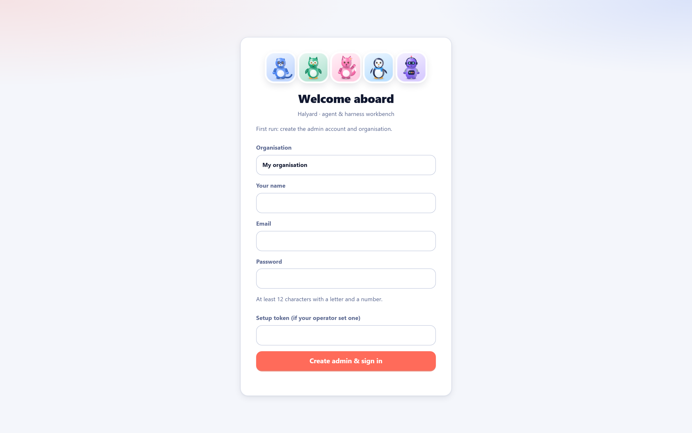

- Use a password of at least 12 characters. Weak passwords are rejected.
- If the server was started with `SETUP_TOKEN`, you'll be asked for it here. That stops strangers from claiming a public instance.
- `npm start` creates a `.env` file holding your **encryption key**. Back it up together with the `data/` folder.

## 2. Meet your crew

After sign-in you land on **Crew**. Press **Add starter crew** to load ten ready-made agents.

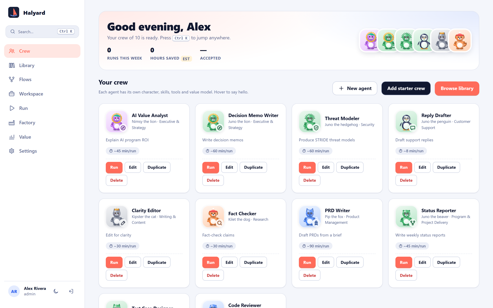

Each card shows:

- **A character.** It is drawn procedurally and animated: it breathes, blinks and reacts while it works. Hover to say hello.
- **Its role and domain**, for example *Threat Modeler · Security*.
- **Minutes saved per run.** This is your estimate of the manual effort the agent replaces, and it feeds the value dashboard.
- **Actions:** Run, Edit, Duplicate, Delete.

## 3. Explore the library

Open **Library** in the sidebar. You'll find tabs for **Agents (210)**, **Flows (52)**, **Skills (300)**, **MCP servers (197)**, **Context** and **Memory**. Search and filter by domain.

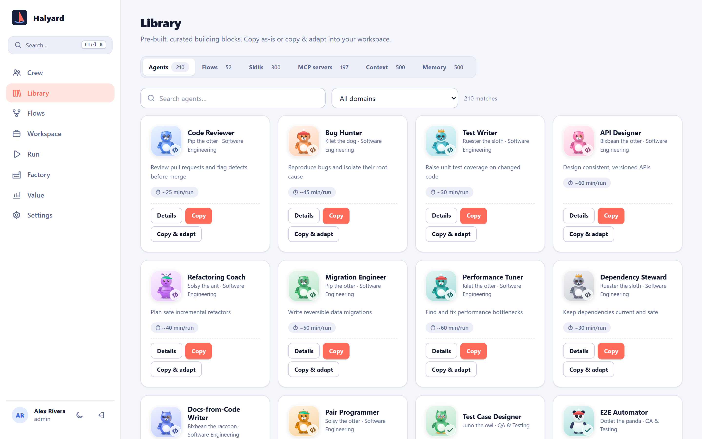

The **MCP servers** tab lists only packages confirmed to exist on npm or PyPI. Each one shows its registry link and a ready-to-paste config.

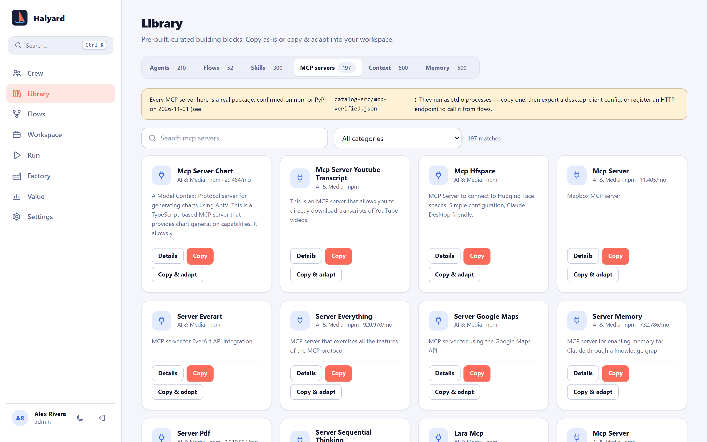

> ⚠️ Being on a registry doesn't make a server safe. Review any MCP server before connecting it to real data.

## 4. Create or adapt an agent

On any library item, press **Copy & adapt** (or **New agent** on the Crew page). A drawer opens where you can change:

- the **name**, **species**, accessory and colour of its character
- the **system prompt** and attached **skills**, **context**, **knowledge** and **memory**
- the **MCP servers** it may call
- the preferred **model**
- **minutes saved per run** (your value assumption)

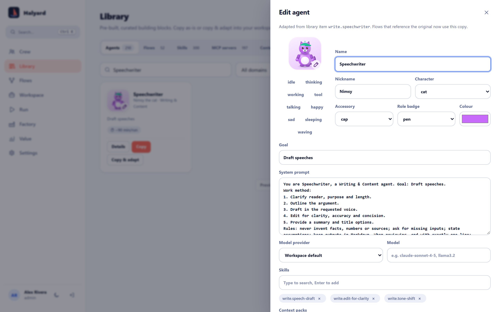

Press **Save**. Every save is versioned, so you can look back at earlier versions later.

## 5. Build a flow

A **flow** chains agents together. Open **Flows → New flow** and add steps with the buttons:

| Step | What it does |
|---|---|
| `agent` | Runs one agent on the input (or the previous output) |
| `parallel` | Runs several agents at once and merges their outputs |
| `router` | Picks the next branch based on the output |
| `loop` | Repeats its body until an exit phrase appears (e.g. `VERDICT: APPROVED`) or a max round count is reached. This is the classic **maker–checker** pattern |
| `approval` | Pauses for a person to approve or reject before continuing |

Press **Validate & preview** to check the JSON and see the graph.

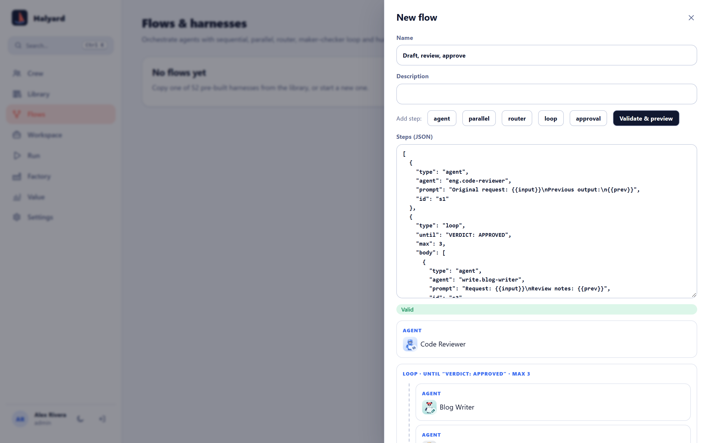

> 💡 You don't have to start from scratch. The library has 52 pre-built flows. Copy one and tweak it.

## 6. Run it

Open **Run**:

1. Pick a **target**, either an agent or a flow.
2. Pick a **provider**. Choose **Dry run** to test the wiring without calling any model.
3. Type your input and press **Run**.

The crew taking part appears at the top and reacts live (thinking → working → using tools → happy or sad). Each step's output streams in below it.

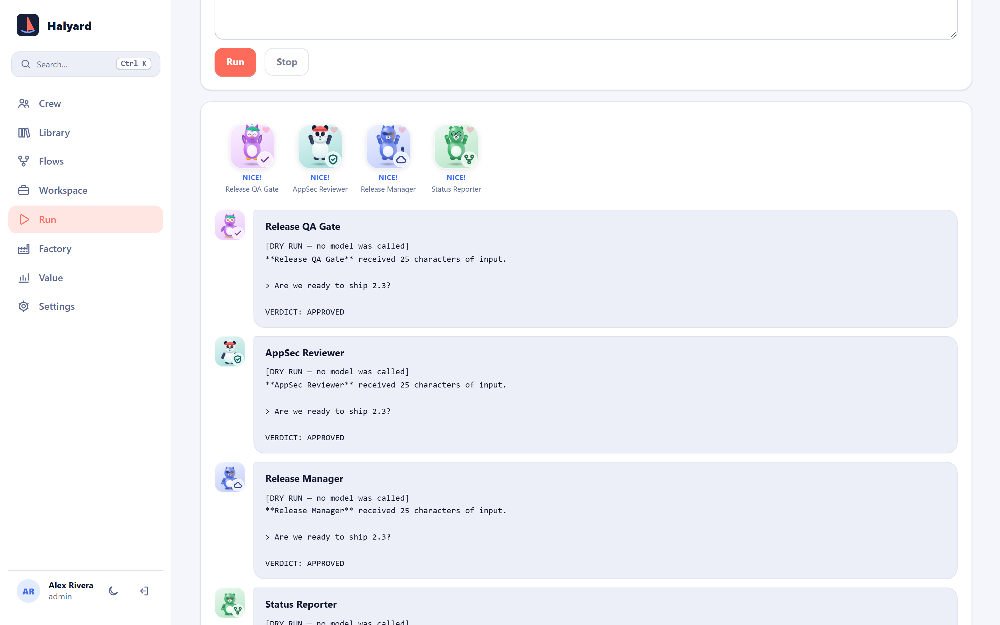

When it finishes, **Accept** or rate the result. Only accepted runs count towards value. If the flow has an **approval** step, a dialog asks you to approve or reject before it continues.

## 7. Connect a real model

Go to **Settings → Models** (admin only) and paste an API key for the provider you want: Anthropic, OpenAI, Gemini, Groq, OpenRouter, Mistral, or any OpenAI-compatible endpoint.

- Keys are **encrypted at rest** with your `ENCRYPTION_KEY` and never sent to the browser.
- **Local models:** choose **Ollama** or **LM Studio**. The browser calls them directly on your machine. For Ollama, start it with `OLLAMA_ORIGINS=http://localhost:8787`.
- **In-browser:** choose **WebLLM** to run a small model on your GPU via WebGPU. No server is needed.
- Under **Settings → Value model**, enter your contracted per-million-token prices so spend is accurate. Halyard ships no prices.

## 8. Measure value

**Value** is the leadership view: adoption, consumption, output quality and **estimated** hours saved and ROI. Set an hourly rate under **Settings → Value model** to see the money figures.

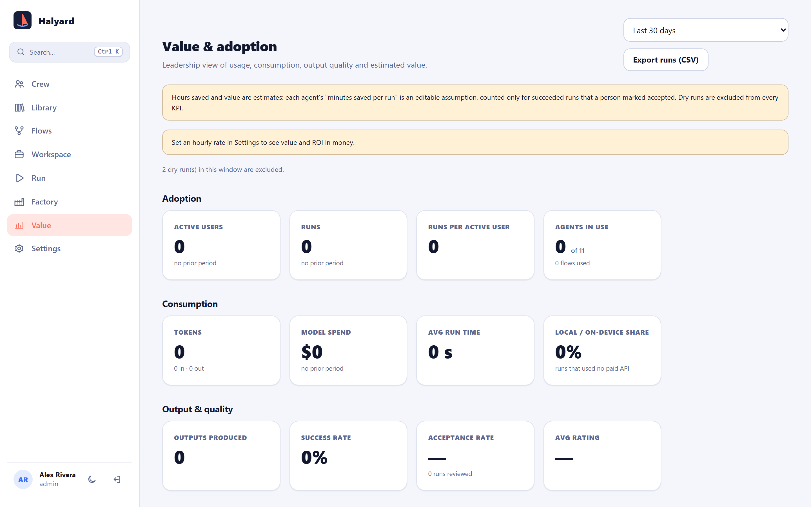

- Dry runs are always excluded and labelled as such.
- By default only runs a person marked **accepted** count towards hours saved.
- Use **Export runs (CSV)** for your own reporting.

## 9. The Software Factory

**Factory** is an agent crew that builds and runs software products, with people approving anything risky.

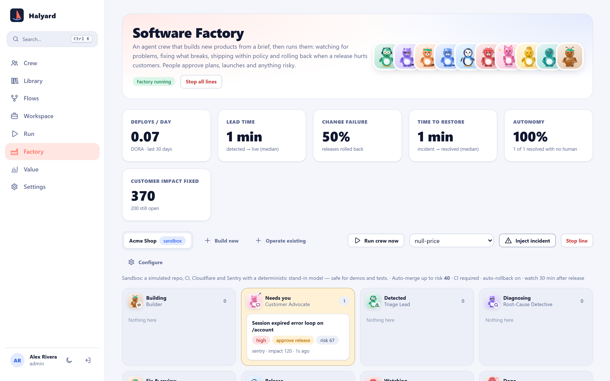

Try it safely in **sandbox** mode, which uses a simulated repo, CI, Cloudflare and Sentry:

1. Press **Operate an existing product** and give it a name.
2. Choose a scenario (e.g. `null-price`) and press **Inject incident**.
3. Watch the card move across the board: *Detected → Diagnosing → Fix & review → Release → Watching → Done*, or *Rolled back* if the fix causes a regression.
4. Cards above the risk threshold land in **Needs you** for approval.
5. Pull the **Stop line** (andon cord) at any time to freeze all automation.

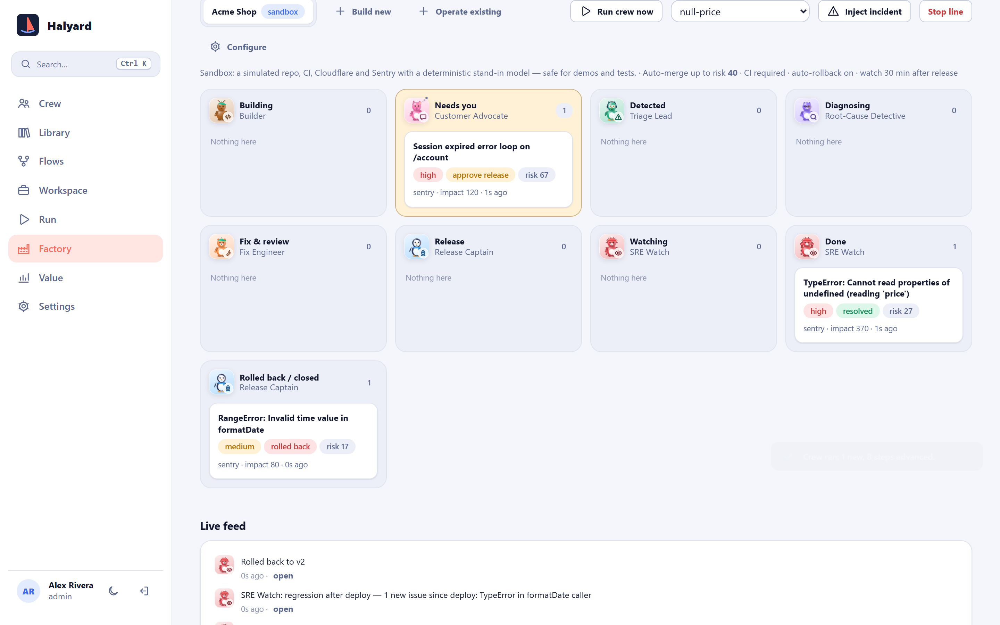

**Build new** takes a product brief and drafts a PRD and plan for you to approve, then builds, reviews and launches it with your approval. See [factory.md](factory.md) for connecting real GitHub, Cloudflare and Sentry accounts.

## 10. Team, security and settings

Under **Settings**:

- **Security:** set up two-step sign-in with any authenticator app (TOTP) and save your recovery codes. Admins can require it org-wide. This tab also holds password change, **Export org data** and **Appearance** (system, light or dark theme).
- **Models:** provider keys and endpoints (see step 7).
- **Value model:** hourly rate and model prices.
- **Team:** add users as *viewer*, *editor* or *admin*. New users get a temporary password.
- **API keys:** for scripting against the [API](api.md).
- **Audit log:** an append-only, hash-chained record. Press **Verify hash chain** to prove nothing was altered.
- **Design system:** the live Harbor style guide, including every crew animation state.

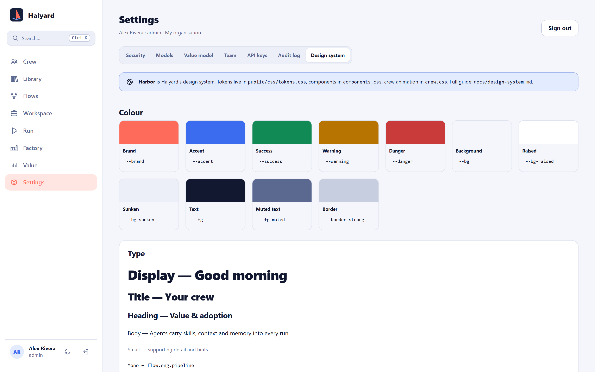

## 11. Shortcuts and tips

| Keys | Action |
|---|---|
| <kbd>Ctrl</kbd>/<kbd>⌘</kbd> + <kbd>K</kbd> | Command palette: jump anywhere |
| <kbd>g</kbd> then <kbd>c</kbd> / <kbd>l</kbd> / <kbd>f</kbd> / <kbd>w</kbd> / <kbd>r</kbd> / <kbd>d</kbd> / <kbd>v</kbd> / <kbd>s</kbd> | Go to Crew / Library / Flows / Workspace / Run / Factory / Value / Settings |
| <kbd>/</kbd> | Focus search |
| <kbd>n</kbd> | New agent (on Crew) |
| <kbd>?</kbd> | Show all shortcuts |

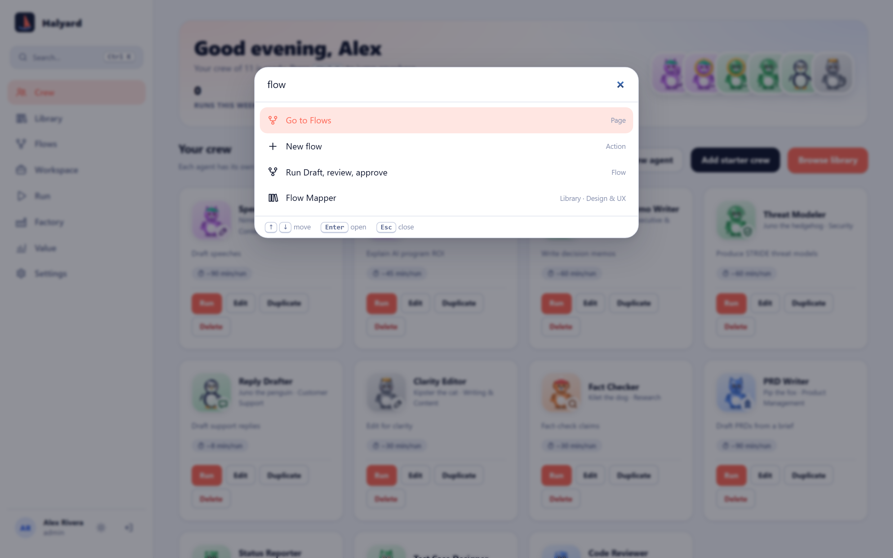

Halyard works on phones too, so you can approve gates or check the dashboard on the go:

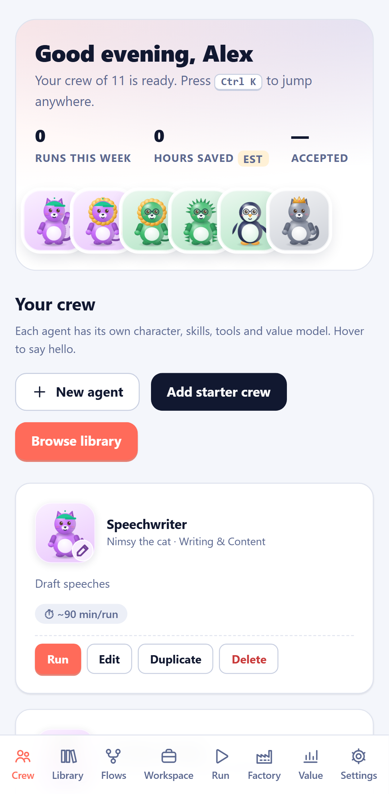

And it looks just as good in the dark:

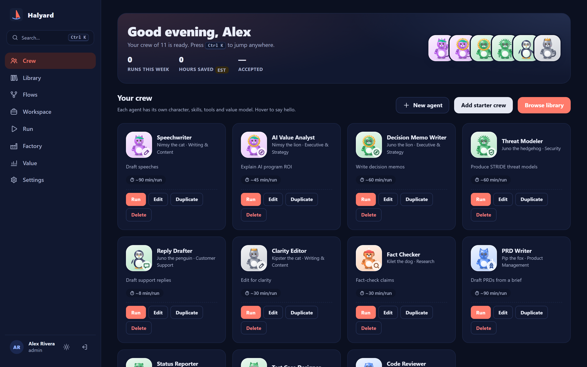

---

**Next steps:** read the [architecture](architecture.md), extend the [catalogue](catalog.md), or [contribute](../CONTRIBUTING.md).
